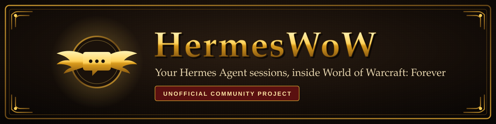
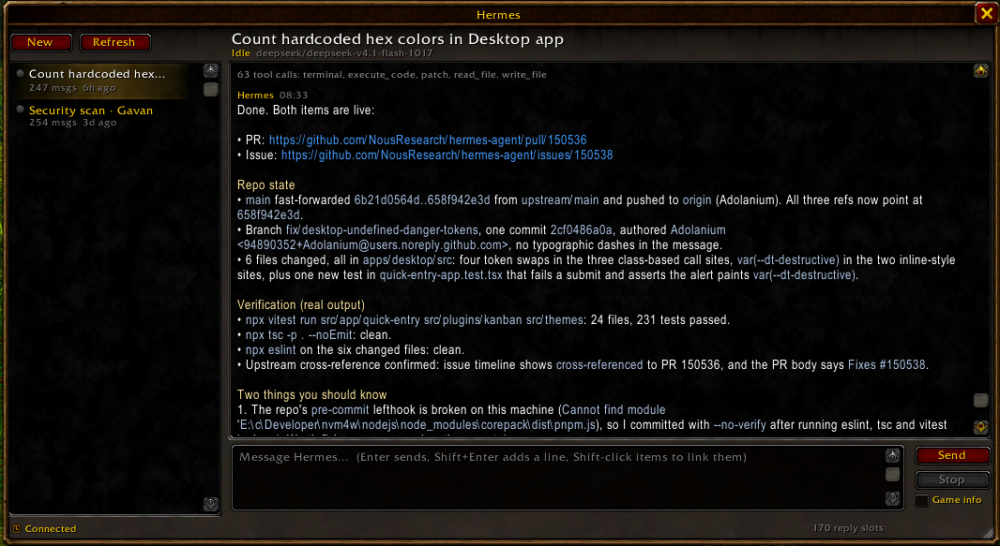

<p align="center">
  
</p>

<p align="center">
  
  
  
  <br>
  
  
  
  
</p>

> [!IMPORTANT]
> **HermesWoW is an unofficial, fan-made community project.** It is not affiliated with,
> endorsed by, sponsored by or supported by Blizzard Entertainment, Nous Research or the Hermes
> Agent project. See [Disclaimer](#disclaimer).

Talk to your local [Hermes Agent](https://github.com/NousResearch/hermes-agent) sessions from
inside World of Warcraft: Forever.

Type `/hermes` in game. A window lists your Hermes sessions and shows their history. You can
continue a session, start a new one, stop running work and answer Hermes's questions while the
game keeps running.

<p align="center">
  
  <br>
  <sub>A Hermes reply in game, rendered from Markdown with the client's own frames, fonts and buttons.</sub>
</p>

## Features

- Session list with live status: working, waiting for you, unread reply.
- Full conversation history, rendered from Markdown, with copyable links.
- Continue any existing session with its context, or start a new one with a model you pick.
- Stop a running turn. Answer clarify questions and command approvals.
- Ask from the chat line with `/hermes ask`; the reply appears in chat.
- Attach a screenshot of the game, so Hermes sees what you see (`/hermes look`).
- Search, pin and rename sessions.
- Combat-aware: the window steps aside in combat, and notifications wait until it ends.
- Shift-click items, spells and quests into a message. Hermes gets their tooltip text.
- Optional game info (zone, target, health, quest log) sent to the model with each message.
- Sound, toast and minimap badge when a reply arrives or Hermes needs you.
- Native WoW look: the client's own frames, fonts, buttons and scroll bars.

## How it fits together

| Part | What it does |
|---|---|
| [`addon/HermesWoW`](addon/HermesWoW) | The in-game window. |
| [`companion/`](companion) | A small Python process on the same PC. It attaches to the Hermes gateway of your profile, the same way Hermes Desktop does. |

Turns run in your Hermes gateway with your profile's model, tools, skills and approval rules.
The companion starts no agent of its own and never reads or stores API keys.

The addon sandbox cannot open sockets or read files. So the addon and the companion talk
through a strip of colored pixels on screen and through files the game loads. See
[How it works](docs/how-it-works.md).

## Quick start

You need Windows, the Forever client in windowed or borderless mode, and Hermes Agent from the
standard Windows installer.

1. Clone this repository into `Interface\AddOns\hermes-forever`.
2. In PowerShell, from the `companion` folder, install the addon:

   ```powershell
   .\start.ps1 -Install
   ```

3. Fully quit and restart the game. A `/reload` does not find new addon files.
4. Start the companion and leave its window open while you play:

   ```powershell
   .\start.ps1          # or double-click start.cmd
   ```

5. In game, type `/hermes`.

## Documentation

- [Installation](docs/installation.md): requirements, install, start, update.
- [Usage](docs/usage.md): the window, links, game info, notifications, slash commands.
- [How it works](docs/how-it-works.md): transport, limits, reload rules, reliability.
- [Security](docs/security.md): what the addon and the companion can and cannot do.
- [Troubleshooting](docs/troubleshooting.md): status bar messages and fixes.
- [Development](docs/development.md): project layout and tests.

## Credits

The pixel-strip codec and transport design come from
[wow-ai](https://github.com/chelinho139/wow-ai) (MIT). See
[THIRD_PARTY_NOTICES.md](THIRD_PARTY_NOTICES.md).

## Disclaimer

HermesWoW is an unofficial, fan-made community project, built and maintained independently.

- It is **not** affiliated with, endorsed by, sponsored by or supported by **Blizzard
  Entertainment**. World of Warcraft and Blizzard Entertainment are trademarks or registered
  trademarks of Blizzard Entertainment, Inc. in the U.S. and other countries.
- It is **not** affiliated with, endorsed by, sponsored by or supported by **Nous Research** or
  the **Hermes Agent** project. Hermes Agent is a project of Nous Research.
- Names are used only to say what HermesWoW works with. This repository contains no game files,
  no Blizzard art and no Nous Research logos. The banner and emblem are original work.
- HermesWoW uses only the normal addon API in game: no memory reading, no injection, no
  automation of gameplay. You use it at your own risk and are responsible for following the
  rules of the game and server you play on.
- Please send questions and bug reports about HermesWoW to this repository's
  [issues](https://github.com/Adolanium/hermes-forever/issues), not to Blizzard or Nous Research.

## License

[MIT](LICENSE). Third-party code: [THIRD_PARTY_NOTICES.md](THIRD_PARTY_NOTICES.md).
